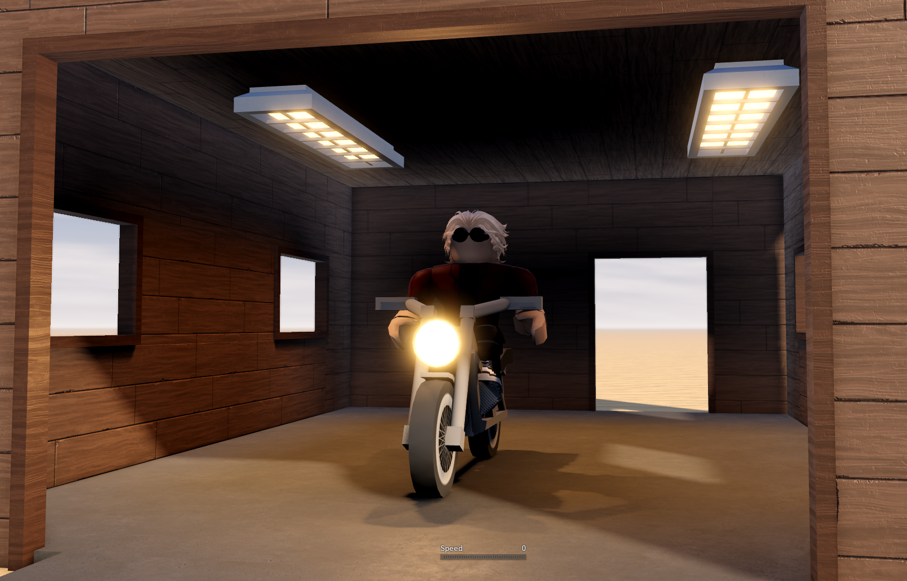
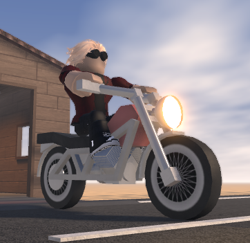

# Who Am I?
I'm twenty years old with somewhat eleven years of experience on ROBLOX Developing, I've always adored this platform as it allows for so many people to pick up game development and coding in general so much easier than other engines, I haven't created any long-running games but I have assisted many other developers with issues and possible improvements to their games.

My goal is to strive to create a game that will have more than one-hundred players at some point, at the time of writing this (13-10-2026) I have NOT achieved that goal.

# Here's How My Work Looks:
## [Journey](https://www.roblox.com/games/80135353007340/Journey)
A game made in a few hours then improved over a few days idly, it's a game where all you do is drive anywhere forever, it was an experiment to see if I properly knew chunking, constraints, optimizations and replication.

  
  
  
  

## Robotnik's Emerald Praise

# What About Contacting You?
You can contact me by sending a friend request on Discord to the account "vrs2210" or sending a message to be on Roblox under the same name.

# And Lastly, What Payment Options?
I accept via [Paypal](https://paypal.me/Khaelises) or by Roblox Group Funds.
